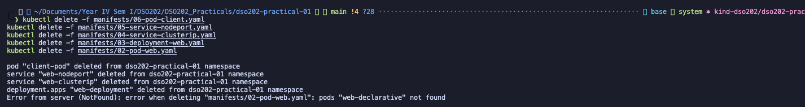
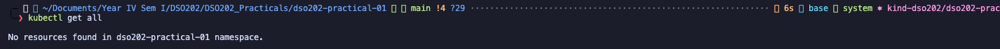
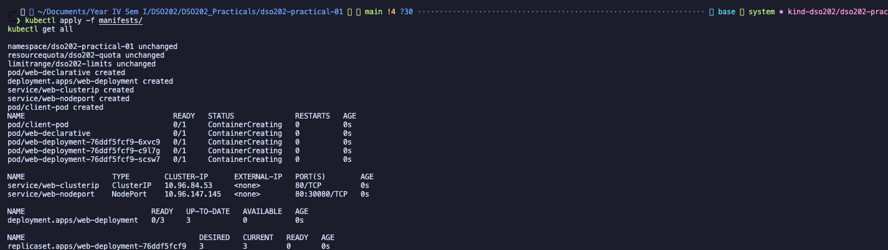
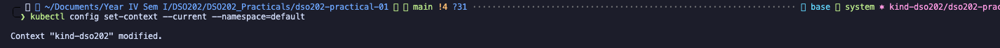
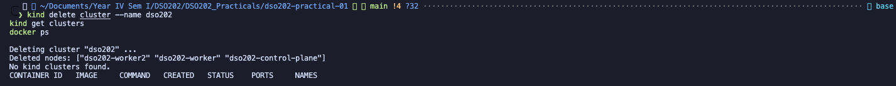
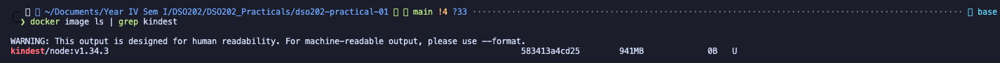

# DSO202 Practical 01 Report

## Setting Up a Local Kubernetes Cluster with kind and Deploying Workloads

## 1. Objective

The objective of this practical was to create a reproducible three-node Kubernetes cluster with kind, inspect its components, deploy workloads, and expose them through Kubernetes Services. The practical also covered declarative configuration, namespaces, resource quotas, limit ranges, labels and selectors, troubleshooting, Deployments, rolling updates, rollback, readiness, service discovery, NodePort access, and cleanup.

## 2. Environment

| Component          | Version or details                                         |
| ------------------ | ---------------------------------------------------------- |
| Operating system   | macOS on Apple Silicon (`darwin/arm64`)                    |
| Docker             | 29.4.3                                                     |
| kind               | v0.32.0                                                    |
| kubectl client     | v1.36.1 (originally v1.34.1, outside the supported skew; see Reflection) |
| Kubernetes cluster | v1.36.1                                                    |
| Cluster runtime    | containerd 2.3.1 in Debian GNU/Linux 13 kind nodes         |
| Cluster            | `dso202`, with one control-plane node and two worker nodes |

The captured node output shows all three nodes in the `Ready` state and running Kubernetes `v1.36.1`.

## 3. Procedure and Observations

The procedure below records what was done, the screenshot that provides evidence, and what the output demonstrates.

### 3.0 Stage 0 - Prerequisites and Verification

---

Each tool was verified on its own first, so that any later failure could be traced to a single cause.

**Step 1:** Confirmed the Docker daemon is running and reachable.


**Step 2:** Confirmed kind is installed.


**Step 3:** Confirmed kubectl is installed, using `--client` because no cluster existed yet.


All three commands printed a version, so the checkpoint was met.

### 3.1 Stage 1 - Creating the Three-Node Cluster

---

**Step 1:** Cluster Configuration

Created the cluster configuration file by copying the multi-node specifications from `DSO202_Practical1_Manifests.md` into `cluster/kind-cluster.yaml`.

What is there in the configuration file:
the code configures a local Kubernetes cluster named **dso202** using **Kind**.

It sets up:

- **Networking:** Localhost access (`127.0.0.1`), plus custom IP ranges for Pods and Services.
- **3 Nodes:** 1 control plane node and 2 worker nodes running Kubernetes `v1.36.1`.
- **Port Forwarding:** Exposes host port `30080` to access internal cluster services.

**Step 2:** Cluster Creation
Executed the kind command to create the 3-node Kubernetes cluster using the prepared configuration file which is there in manifest as shown below:


So the cluster is created successfully and also checked whether it exist or not in the second command line, which exist as `dso202`. I also checked the nodes in the cluster in third command line, which shows the 3 nodes in the cluster.

**Step 4:** Confirmed the same three nodes exist as Docker containers. The container names (`dso202-control-plane`, `dso202-worker`, `dso202-worker2`) are chosen by kind and differ from the Kubernetes Node object names set by the kubeadm patches.


**Step 5:** Confirmed kubectl points at the new cluster. kind adds a context named `kind-<cluster-name>` and selects it automatically.


So the creation of the cluster is successful and the current context is configured to use the newly created cluster.

### 3.2 Stage 2 - Inspecting the Cluster and Its Components

---

This stage is important because we can know how to directly query, inspect and verify those running processes and components in the cluster. It is also important to know how to check the status of the cluster and its components.

**Step 1:** One of the methods is checking where the control plane is as shown below:


So as we can see the information about the control plane where it is running at `http://127.0.0.1:55489` and the coreDNS is running at `http://127.0.0.1:55489/api/v1/namespaces/kube-system/services/kube-dns:dns/proxy`.

**Step 2:** Listing the nodes in the cluster and checking their status as shown below:


From the above image, we can conclude that only the control plane node is assigned the role.

The worker nodes are assigned `<none>` for the roles as kind assigned no roles for the worker nodes. It gets its role when we deploy workloads to the cluster.

**Step 3:** Now lets use `-o wide` option in the command line to get more information about the nodes in the cluster as shown below:


Can also be used for getting pod information as well.

**Step 4:** This step uses `kubectl describe` to inspect `worker-node-1`, verifying its custom metadata labels, available hardware resources (CPU/memory), and currently running Pods as shown below:


Lets see a clean list of lables that is being assigned to worker-node-1 as shown below:


**Step 5:** Getting the namespaces in the cluster and checking their status as shown below:


**Step 6:** Listing out the components of control plane which runs as pod in kube-system as shown below:


**Three Observations that are made are:**

- **Control Plane Components:** `etcd`, `kube-apiserver`, `kube-controller-manager`, and `kube-scheduler` run only once on the control-plane node to manage the cluster.
- **Cluster-Wide Networking:** `kube-proxy` and `kindnet` run on all three nodes to handle networking everywhere across the cluster.
- **Core DNS Service:** `coredns` runs twice on the control-plane node because it has special permission to run there, unlike ordinary application Pods.

**Step 7:** This command fetches and displays the 10 most recent log entries from the Kubernetes scheduler running in the system namespace as shown below:


It allows us to inspect the control plane's core scheduling activity using the exact same logging method used for standard application pods.

**Step 8:** In this step, it is querying the API server to separate namespaced resources from cluster-scoped ones, I have learned which objects require a `-n` flag so we can avoid scope-related command errors as shown below:


So the namespaces resources require a `-n` flag to avoid scope-related command errors like from image and text it is pod, Service, Deployment, ConfigMap, ResourceQuota, LimitRanges and PersistentVolumeClaims.

### 3.3 Stage 3 - Namespaces, Resource Quotas and Limit Ranges

Namespaces, ResourceQuotas, and LimitRanges form the foundation of Kubernetes multi-tenancy, it allows a multiple users or environments to share a single cluster securely without resource starvation or name collisions.

- **Namespace:** A logical partition inside the cluster that isolates object names, access controls, and quotas. It does not isolate network traffic by default.

- **ResourceQuota:** Sets strict maximum limits on total compute usage (e.g., CPU) and object counts (e.g., total Services) within a namespace. Once active, all pods must specify resource requests/limits or be rejected.

- **LimitRange:** Works alongside a ResourceQuota to automatically inject default CPU/memory requests and limits into containers that don't declare them.

**Step 1:** Practicing a imperative namespace creation (kubectl create ns) and deleting it to learn the workflow before moving to standard declarative YAML manifests as shown in the given figure below:


**Step 2:** Lets use a single command which is imperative to preview what the software setup file looks like before creating it.

So, when we compare that generated setup file to a saved version, we can notice that the generated one is missing the labels.


**Step 3:** Copying the Listing 2 into manifests/00-namespace.yaml and applying it as shown below:


**Step 4:** Setting the namespace as the default for the current context. Every subsequent command in this practical then omits `-n` as shown below:


**Step 5:** Copying Listing 3 into manifests/01-quota-and-limits.yaml and applying it. The file contains two objects separated by --- as shown below:


**Step 6:** Reading the quota. The Used column is what makes a quota useful during troubleshooting as shown in the given figure below:


Every Kubernetes namespace automatically comes with one built-in system file called `kube-root-ca.crt`, which helps applications securely connect to the cluster.

Because a ResourceQuota counts every single object that exists inside a namespace, this automatic system file is recorded immediately, showing 1 ConfigMap used before we create anything.

**Step 7:** Reading the limit range as shown below:


**Step 8:** Testing whether the LimitRange rules are working automatically.

We will create a container without specifying any memory or CPU requirements, then check the container's final saved settings to confirm that Kubernetes automatically assigned it the default resource limits we have previously defined in the LimitRange like this :


When we create a container without specifying CPU or memory settings, the LimitRange automatically assigns it default CPU and memory values (both requested amounts and maximum limits).

Because the namespace has a ResourceQuota requiring every container to state its resource needs, the container would normally be rejected for leaving those values blank. The LimitRange fills in those required settings automatically, allowing the container to run successfully.

**Step 9:** Delete the check Pod, since it is not part of the deliverable.


### 3.4 Stage 4 - Pods

We know that a Pod is the smallest deployable unit in Kubernetes, it is a logical host for one or more containers. It provides a shared network and storage environment for its containers, and it manages their lifecycle as a single entity.

#### 3.4.1 The imperative route

**Step 1:** Create a Pod with one command, then inspect it.


In the above image, the three flags and its effect are:

- `--restart=Never`: It is a bare pod, without it, older kubectl versions produced other object types; stating it removes all ambiguity.
- `--port=80`: It is a container port, not a host port; it is used for service discovery and load balancing.
- `--labels=`: It attaches metadata to the Pod, which is useful for selecting it later with a Service or Deployment.

**Step 2:** Watch the Pod reach Running. `Press Ctrl+C` to stop watching.


**Step 3:** Capture the imperative Pod as a manifest. This is the bridge between the two styles.


So using `kubectl get pod web-imperative -o yaml > evidence/web-imperative-as-stored.yaml` command, it generated a manifest file that is a snapshot of the Pod's current state. This file can be used to recreate the Pod later or to understand its configuration.

**Step 4:** Deleting the imperative Pod.


#### 3.4.2 The declarative route

**Step 5:** Copying the Listing 4 into manifests/02-pod-web.yaml and running it to create the Pod.


**Step 6:** Applying the same file a second time without changing it.


**Step 7:** Confirming the Pod's placement and the assigned Pod IP.


So the `NODE` column may show either worker. The scheduler chose it; the manifest did not. The IP is a cluster-internal Pod address from the range configured in Listing 1, and it is not reachable from the host.

**Step 8:** Confirm the resource declarations took effect.


These values came from the manifest file.

Lets verify by re reading the quota.


**Step 9:** Describe the Pod and read the Events: section at the bottom.


The **From** column highlights how responsibility shifts between Kubernetes control plane and worker node components during deployment: **`default-scheduler`** evaluates cluster resources to choose `worker-node-2`, after which the local **`kubelet`** agent takes over to verify the cached `nginx:1.30-alpine` image, create the container, and start it running.

#### 3.4.3 Labels and selectors

**Step 10:** Display labels alongside the Pod list.


**Step 11:** Select Pods by label rather than by name. This is how every controller and every Service finds its Pods.


The first three commands list `web-declarative`. The fourth prints `No resources found in dso202-practical-01 namespace.`

**Step 12:** Adding a label to the Pod and then removing it at runtime. The trailing hyphen removes a label.


**Step 13:** Add an annotation and observe that it cannot be selected on.

This labels are for machines to select on; annotations are for humans and tools to read.


#### 3.4.4 Debugging and troubleshooting commands

**Step 14:** Read the container's log stream. `-f` follows it; `--tail` limits the history.


**Step 15:** Open a shell inside the running container. Because `nginx:1.30-alpine` is Alpine-based, the shell is sh, not bash.


**Step 16:** Run a single command inside the container without an interactive session.


**Step 17:** Forward a local port to the Pod. This opens a tunnel from the host, through the API server, to the Pod. It is intended for debugging, never for exposing an application.


Leave that command running, and in a second terminal:


**Step 18:** Use kubectl explain whenever a field is unfamiliar. It reads the schema from the live cluster, so its answer is always correct for the running version.


Checkpoint: `web-declarative` is Running and 1/1, its labels are visible with --show-labels, and kubectl logs, kubectl exec, and kubectl port-forward have all produced output.

#### 3.4.5 Common pitfalls in this stage

- **Alpine Shell Error:** Alpine images ship with `sh`, not `bash`. Use `kubectl exec -it <pod> -- sh` to avoid the `executable file not found in $PATH` error.
- **Pod Network Access:** Pod IPs only exist within the internal cluster network. Use `kubectl port-forward` or a Kubernetes Service to connect from the host.
- **Immutable Pod Specs:** Most Pod fields cannot be updated live via `kubectl edit`. Modify your manifest file and re-apply (`kubectl apply`) to recreate the Pod.
- **Multi-Container Logs:** Running `kubectl logs` without specifying a container fails on multi-container Pods. Target the intended container using `-c <container_name>`.
- **Pod Naming Restrictions:** Kubernetes object names must contain only lowercase alphanumeric characters, `-`, or `.`. Uppercase letters and underscores are invalid.

### 3.5 Stage 5 — Deployments

#### 3.5.1 Definitions

**Why Deployments Matter**

- Standalone Pods do not recover if deleted. Deployments make workloads production-ready by ensuring guaranteed replica counts, zero-downtime version updates, and simple rollbacks.

**Chain of Ownership**

- **Deployment** _(strategy, revision history)_ $\rightarrow$ **ReplicaSet** _(replica count, label selector)_ $\rightarrow$ **Pods** _(containers, volumes, probes)_

**Core Controllers**

- **ReplicaSet:** Runs a control loop using label selectors to maintain a set number of running Pods. Rarely created manually.
- **Deployment:** Manages ReplicaSets. On updates, it creates a new ReplicaSet, gradually migrates Pods over, and scales the old ReplicaSet to zero (enabling instant rollbacks).

**Deployment Strategies**

- **RollingUpdate (Default):** Replaces Pods incrementally for zero downtime.
- `maxUnavailable`: Maximum allowed Pods offline during an update.
- `maxSurge`: Maximum allowed temporary Pods above the target replica count.

- **Recreate:** Deletes all existing Pods before creating new ones (causes downtime; used when legacy versions cannot run concurrently).

#### 3.5.2 Steps

**Step 1:** Generating a Deployment manifest imperatively, purely for comparison. Then reading Listing 8 and note everything the generated version omits: labels beyond the bare minimum, resource declarations, probes, a rollout strategy, and comments.


**Step 2:** Copying Listing 5 into manifests/03-deployment-web.yaml and apply it.


**Step 3:** Observe the three-level ownership chain in the cluster.


The two naming rules are visible. The ReplicaSet name is the Deployment name plus a hash of the Pod template. Each Pod name is the ReplicaSet name plus a random suffix. Because the hash is derived from the template, any change to the template produces a new ReplicaSet name.

**Step 4:** Confirm the ownership relationship rather than inferring it from names.


**Step 5:** Confirm the scheduler spread the replicas across the worker nodes.


The exact distribution varies. The point is that the manifest never named a node; the scheduler placed each Pod.

**Step 6:** Demonstrate self-healing. Delete one Pod and immediately list them again.


A replacement Pod appears within seconds, with a new random suffix but the same ReplicaSet prefix. This before-and-after listing is the clearest illustration of reconciliation in the practical: the ReplicaSet, not the Deployment, noticed the missing Pod and created a new one.


#### 3.5.3 Scaling

**Step 7:** Scale imperatively, then read the result.


**Step 8:** Return to three replicas the declarative way, by re-applying the unmodified manifest.


This is the reason imperative changes are unsuitable for graded work: the next apply silently reverses them. Whatever the manifest says wins. In Unit IV, ArgoCD enforces exactly this property continuously.

#### 3.5.4 Rolling update and rollback

I watched the rollout, changed the image to `nginx:1.31-alpine`, inspected the ReplicaSets and revision history, and rolled back to the previous working revision.


The rollout status shows new replicas becoming ready before old replicas are removed.


Changing the image updates the Pod template and creates a new Deployment revision.


The active ReplicaSet contains the new Pods while the previous ReplicaSet is scaled to zero.


The revision history records the available Deployment versions.


The detailed output identifies the image and template used by the selected revision.


The rollback restores the previous working image and configuration.

I deliberately changed the image to `nginx:9.99-does-not-exist` to simulate a failed release.


The invalid image prevents the new Pod from becoming ready.


The rollout stalls while healthy existing replicas remain available because `maxUnavailable: 0`.


The diagnostic output identifies `ErrImagePull` and `ImagePullBackOff`; undoing the rollout returns the Deployment to a working revision.


Re-applying the manifest makes the running cluster agree with the declared repository state.

### 3.6 Stage 6 — Services

I applied the ClusterIP Service and inspected the EndpointSlice generated for its selector.


The Service selects Pods labelled `app=web,tier=frontend`.


The EndpointSlice lists the ready Pod addresses that receive Service traffic.

I created `client-pod` to test DNS and HTTP access from inside the cluster.


The client Pod provides an in-cluster source for service discovery tests.


DNS resolves the Service name to its ClusterIP rather than to an individual Pod IP.


The HTTP response confirms that the ClusterIP Service forwards traffic to the web Pods.


Requests return different Pod hostnames, demonstrating load balancing across ready endpoints.

I removed `/index.html` from one Pod to test readiness independently from liveness.


**The first attempt did not work.** After deleting the file the Pod still showed `1/1`, and the EndpointSlice still listed every address. Running `kubectl describe pod` showed no `Unhealthy` events, and `kubectl get deployment web-deployment -o yaml` showed why: the Deployment had no `readinessProbe` or `livenessProbe` at all. The guide refers to a probe on `/index.html`, but the copied Listing 5 did not contain one, so nothing was checking the file.

I added a `readinessProbe` (HTTP GET `/index.html`) and a `livenessProbe` (TCP on the `http` port) to `manifests/03-deployment-web.yaml` and re-ran the test on a freshly built cluster. The full output is in [`evidence/stage6-readiness-test.txt`](../evidence/stage6-readiness-test.txt):

```text
$ kubectl get pod "$target"
NAME                              READY   STATUS    RESTARTS   AGE
web-deployment-5d8696bcfb-lrkck   0/1     Running   0          2m17s

$ kubectl get endpointslice ... -o jsonpath=<address, ready, pod>
10.244.1.2  ready=true   pod=web-deployment-5d8696bcfb-pdhpc
10.244.1.3  ready=false  pod=web-deployment-5d8696bcfb-lrkck
10.244.2.2  ready=true   pod=web-declarative
10.244.2.3  ready=true   pod=web-deployment-5d8696bcfb-wqkqn

Warning  Unhealthy  kubelet  Readiness probe failed: HTTP probe failed with statuscode: 404

$ (12 requests through web-clusterip)
   2 served by web-declarative
   3 served by web-deployment-5d8696bcfb-pdhpc
   7 served by web-deployment-5d8696bcfb-wqkqn
```

The Pod stays `Running` with `RESTARTS 0`, because the TCP liveness probe still passes, but its readiness is `0/1` and it receives no traffic: the broken Pod's name is absent from the 12 responses. Two details are worth recording:

- The default `kubectl get endpointslice` ENDPOINTS column still shows the unready address. Modern EndpointSlices keep unready endpoints and mark them `ready=false` instead of deleting them, so the `conditions.ready` field has to be read to see the change.
- `web-declarative`, the bare Pod from Stage 4, also carries `app=web,tier=frontend`, so the Services select it as well. The EndpointSlice therefore has four addresses, not three. A selector matches labels, not owners.

Restoring the file made the probe pass again within about 10 seconds. The Pod returned to `1/1` and its endpoint to `ready=true`.

I created a Service with a selector that matched no Pods and then deleted it.


The empty EndpointSlice identifies a selector mismatch and explains why the Service has no backends.


The output confirms that the diagnostic Service was removed.

I applied the NodePort Service and tested it from the host.


The Service exposes port 80 as node port `30080`.


The host request succeeds through kind's published port without a port-forward.


The node port is configured on all three nodes, although only the control-plane port is published directly to the host.


The `EXTERNAL-IP` remains `<pending>` because kind has no cloud provider to provision an external load balancer.

### 3.7 Stage 7 — Cleanup and reproducibility

I captured the final state before deleting the cluster.


This first capture showed `web-deployment 5/5`, even though the manifest declares `replicas: 3`. The imperative `kubectl scale --replicas=5` was still in effect, so the cluster and the repository disagreed.

After adding the probes I rebuilt the cluster from the repository, applied `manifests/`, and captured the final state again ([`final-state-all.txt`](../evidence/final-state-all.txt), [`final-state-nodes.txt`](../evidence/final-state-nodes.txt), [`final-state-events.txt`](../evidence/final-state-events.txt)). It shows `web-deployment 3/3` on `nginx:1.30-alpine`, one ReplicaSet, the bare Pod, the client Pod, both Services, the quota, the limit range, and the EndpointSlices. [`final-state-verification.txt`](../evidence/final-state-verification.txt) records the declarative check:

```text
$ kubectl diff -f manifests/ && echo "cluster matches repository"
cluster matches repository
```

It also records that `curl http://localhost:30080` answers from several Pods, and that `web-clusterip` resolves to `web-clusterip.dso202-practical-01.svc.cluster.local`.

I deleted the workload objects using the declarative manifests.



Deleting from the same files that created the objects confirms that the workload is represented in the repository.



The namespace is empty of application workloads while its resource-management objects remain.

I rebuilt the workload from the numbered manifests.



Applying the directory in lexical order demonstrates reproducibility from the repository files.



Resetting the context prevents later commands from silently targeting the practical namespace.



The output confirms that the local Kubernetes cluster was deleted.



The optional cleanup removes the cached node image and reclaims disk space.

## 4. Analysis

The practical shows that Kubernetes is declarative and reconciliation-based. A manifest describes the desired state, while controllers continually work to make the actual state match it. This explains why re-applying the Deployment restored its declared replica count and why deleting one of its Pods caused a replacement to appear.

The Deployment, ReplicaSet, and Pod have separate responsibilities. The Deployment manages rollout strategy and revision history, the ReplicaSet maintains the replica count, and the Pods run containers. During a rolling update, `maxUnavailable: 0` prevents the ready replica count from dropping below the required level. The invalid-image test showed that a bad revision can stall without immediately removing the healthy Pods.

Labels are used by controllers and Services for selection, while annotations store descriptive metadata and cannot be used as selectors. A matching Service selector creates EndpointSlice entries for ready Pods. A selector that matches nothing creates an empty EndpointSlice and cannot forward application traffic.

Readiness and liveness serve different purposes. Readiness controls whether a Pod receives Service traffic, while liveness determines whether Kubernetes should restart the container. Removing `/index.html` failed readiness but not liveness, so the Pod stayed Running while traffic was removed from it.

ResourceQuota limits total resource usage and object counts in a namespace. LimitRange supplies default requests and limits to individual containers. The check Pod demonstrated that these defaults allow a container without explicit resources to satisfy the quota policy. The automatically created `kube-root-ca.crt` ConfigMap explains the initial ConfigMap usage.

ClusterIP provides internal access through DNS and a virtual IP. NodePort provides access through a port on every node, and kind's port mapping made `localhost:30080` reachable from the host. A LoadBalancer Service remained pending because a local kind cluster has no cloud controller to create an external load balancer.

## 5. Reflection

The most difficult part was distinguishing the roles of Pods, ReplicaSets, Deployments, and Services because one declarative workflow creates several related objects. Owner references, labels, EndpointSlices, and Events helped clarify those relationships.

The most instructive error was one I did not plan. In Stage 6 Step 7 I deleted `index.html` expecting the Pod to leave the Service, and at first glance the output seemed to agree, because the Pod was still running and traffic still flowed. Looking more closely, the Pod still reported `1/1`, which a failing readiness probe makes impossible. `kubectl describe pod` showed no `Unhealthy` events, and the Deployment's YAML had no probes. The guide assumed a probe the listing never defined. I added a readiness probe (HTTP `/index.html`) and a liveness probe (TCP), rebuilt the cluster, and the test then behaved as expected: `0/1`, `RESTARTS 0`, `ready=false` in the EndpointSlice, no traffic. The lesson was to check the `READY` column and the Events before believing a result, not just whether requests still succeed.

The second error was version skew. My Homebrew kubectl was v1.34.1, two minor versions behind the v1.36.1 cluster, which is outside the supported range of one minor version. Nothing failed visibly, which is exactly why it went unnoticed until I compared `kubectl version` against the node versions. I re-ran the final checks with a v1.36.1 client and upgraded the Homebrew kubectl.

The third was a drift between the repository and the cluster. My first final-state capture showed five replicas because the imperative `kubectl scale` from Stage 5 was never reverted. `kubectl diff -f manifests/` is the check that would have caught it, and running it is now the last step before any capture.

The deliberate failed rollout with `nginx:9.99-does-not-exist` was diagnosed through the rollout status and the Pod Events (`ErrImagePull`, `ImagePullBackOff`) and recovered with `kubectl rollout undo`. It showed that `maxUnavailable: 0` turns a bad release into a stalled one instead of an outage.

If I repeated the practical, I would run `kubectl diff` before every evidence capture, verify all tool versions against the cluster version at the start, and save command output to named `.txt` files alongside the screenshots.

One point that remains unclear is the exact scheduling score used when replicas are distributed between worker nodes. The practical shows the result of scheduling, but not every internal decision used to produce it.

## 6. References

1. DSO202 Practical 01 instructions and manifest listings supplied with the course materials. Accessed 18 August 2026.
2. Kubernetes documentation, “Pods.” https://kubernetes.io/docs/concepts/workloads/pods/ Accessed 18 August 2026.
3. Kubernetes documentation, “Deployments.” https://kubernetes.io/docs/concepts/workloads/controllers/deployment/ Accessed 18 August 2026.
4. Kubernetes documentation, “Service.” https://kubernetes.io/docs/concepts/services-networking/service/ Accessed 18 August 2026.
5. Kubernetes documentation, “Resource Quotas.” https://kubernetes.io/docs/concepts/policy/resource-quotas/ Accessed 18 August 2026.
6. Kubernetes documentation, “Limit Ranges.” https://kubernetes.io/docs/concepts/policy/limit-range/ Accessed 18 August 2026.
7. kind documentation, “Quick Start.” https://kind.sigs.k8s.io/docs/user/quick-start/ Accessed 18 August 2026.
