# DSO202 Practical 02 Report

## Implementing Persistent Storage for a Stateful Application in Kubernetes

## Contents

1. [Objective](#1-objective)
2. [Environment](#2-environment)
3. [Procedure and Observations](#3-procedure-and-observations)
4. [Analysis](#4-analysis)
5. [Reflection](#5-reflection)
6. [References](#6-references)
7. [Appendix – Repository layout, rebuild and cleanup](#7-appendix--repository-layout-rebuild-and-cleanup)

---

## 1. Objective

Practical 1 only used objects that could be thrown away. This practical is about
workloads whose value is their data. The aim was to learn where Kubernetes
actually writes bytes (PersistentVolumes, PersistentVolumeClaims and
StorageClasses), what happens to those bytes when a Pod, a claim or a whole
cluster is deleted, and why databases are run as StatefulSets rather than
Deployments. It finishes with PostgreSQL 18, the database Assignment 1 uses,
keeping its rows after its Pod was destroyed.

## 2. Environment

Listing 1 (with the node-name patches) worked first time, so the fallback
Listing 1B was not needed: `kubectl get nodes` shows `control-plane`,
`worker-node-1` and `worker-node-2`.

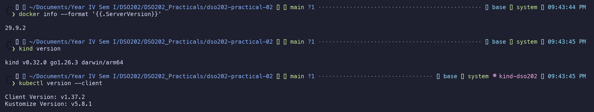

---

## 3. Procedure and Observations

Every stage below gives what was done, the screenshot that proves it, and what
the output shows. All screenshots are from one complete run on 10 November 2026,
and the plain-text output behind each one is in [`evidence/logs/`](evidence/logs/)
under the same name.

### 3.0 Stage 0 – Prerequisites and verification

The three tools reported their versions (above). The Practical 1 cluster
`dso202` was still present, so it was deleted, because two three-node clusters
would exhaust the Docker VM's memory in Stage 7.

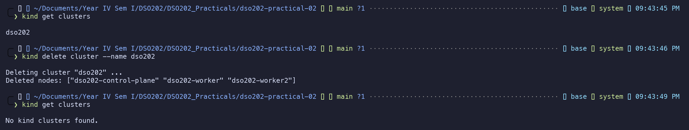

The host directory for the static volume was created **before** the cluster,
because kind mounts it into a node only at creation time.

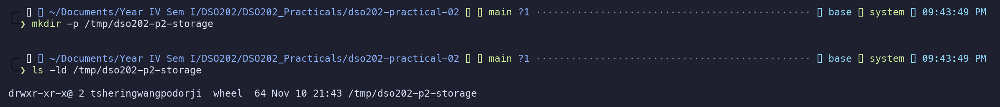

On macOS the host's `df -h /` and Docker's own disk are different filesystems,
so both were checked.

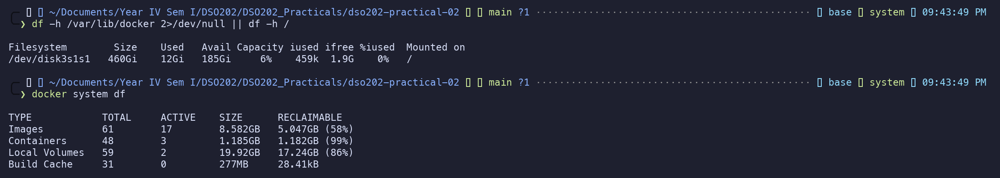

**Checkpoint met:** all three tools print a version, no kind cluster exists, and
`/tmp/dso202-p2-storage` exists.

### 3.1 Stage 1 – Cluster, namespace, and the storage landscape

**Step 1 – Create the cluster.** The line that matters is *Installing
StorageClass*: kind installs a storage provisioner as an add-on, just as it
installs a CNI plugin. A cluster built by hand with `kubeadm` has neither.

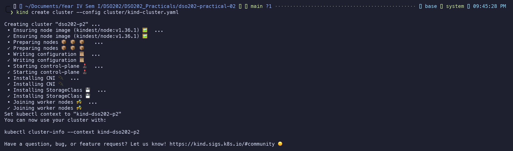

**Step 2 – Nodes and containers.** The kubeadm patches gave the Node objects
their own names, which differ from the Docker container names. The mapping used
for every later `docker exec` is:

| Node object     | Docker container          |
| --------------- | ------------------------- |
| `control-plane` | `dso202-p2-control-plane` |
| `worker-node-1` | `dso202-p2-worker`        |
| `worker-node-2` | `dso202-p2-worker2`       |

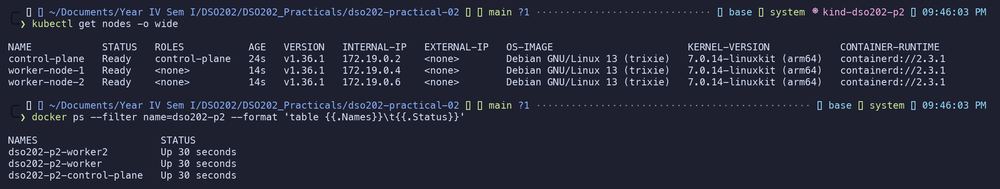

**Step 3 – The host directory reached only `worker-node-1`.**

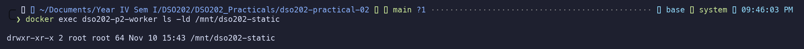

**Steps 4–5 – Namespace, quota and the retaining class.** The namespace was made
the default for the session. The quota adds three storage constraints to
Practical 1's compute limits: a cap on the number of claims (`12`), a cap on
total requested storage (`20Gi`), and per-StorageClass caps (`12Gi` on
`standard`, `4` claims on `dso202-retain`).

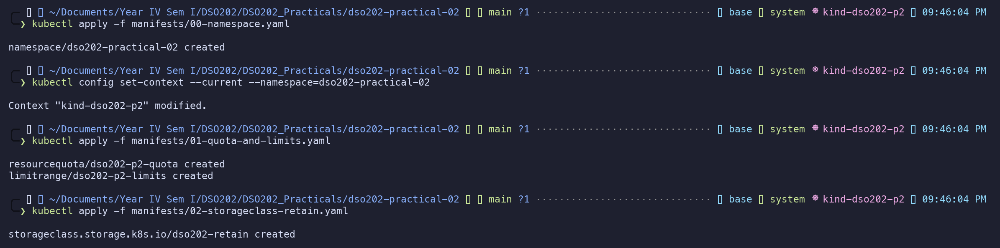

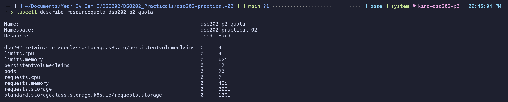

**Step 6 – The StorageClasses.** Both classes use the same provisioner and differ
only in policy: `standard` deletes volumes with their claims, while
`dso202-retain` keeps them. Both use `WaitForFirstConsumer` and neither allows
expansion, which explains the Pending claim and the rejected resize in Stage 3.

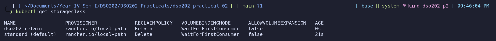

**Steps 7–8 – The provisioner.** Dynamic provisioning is done by an ordinary Pod
in its own namespace, and its ConfigMap says it writes to
`/var/local-path-provisioner` on whichever node the consuming Pod runs on.

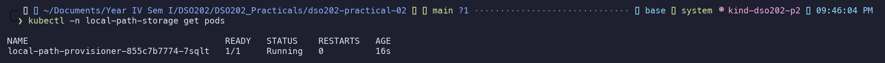

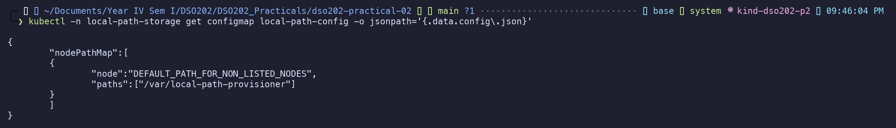

### 3.2 Stage 2 – Static provisioning, and the meaning of Retain

**Steps 1–2 – The PersistentVolume.** It starts `Available`, and it declares
node affinity for `dso202/node-index=1` because the directory exists on one node
only.

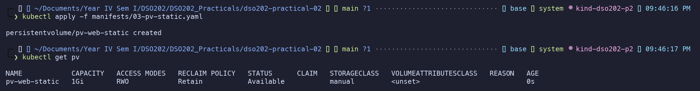

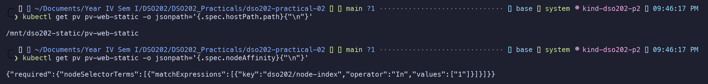

**Steps 3–4 – The claim bound immediately.** No StorageClass called `manual`
exists, so the name is only a matching label. No provisioner and no binding mode
were involved. The control plane found an `Available` PV whose class name,
capacity and access mode satisfied the claim.

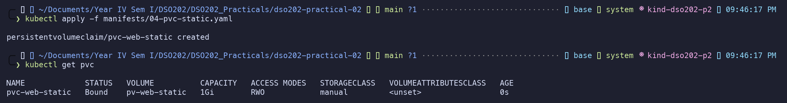

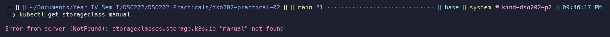

**Steps 5–6 – The volume chose the node.** Listing 7 has no `nodeSelector`, yet
the Pod ran on `worker-node-1`, placed there by the PV's node affinity. The same
line is readable inside the container and on the Mac.

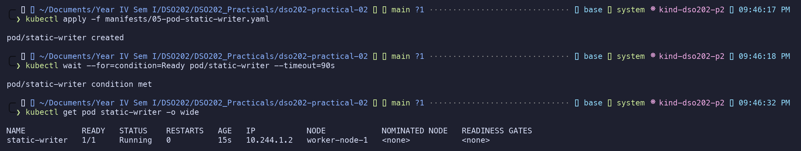

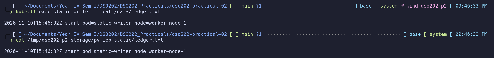

**Step 7 – The data outlives the Pod.** After the Pod was deleted and recreated
there were two lines, the first written by a Pod that no longer existed.

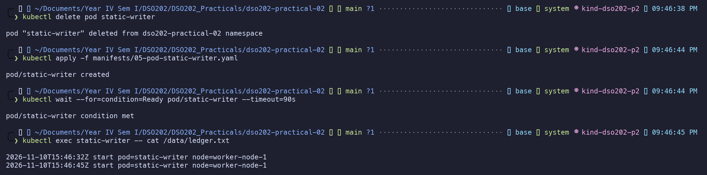

**Step 8 – Released, not Available.** After the claim was deleted, the PV moved
to `Released` and still named the deleted claim. That is the Retain contract:
Kubernetes will not hand one workload's data to the next claim.

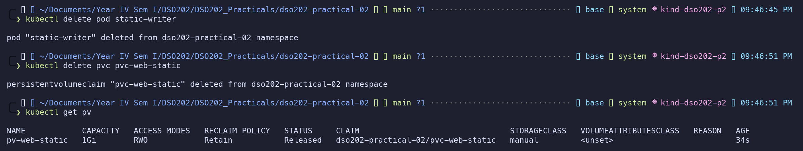

**Step 9 – Deleting the PV deleted no data.** It removed an API entry, not a
byte.

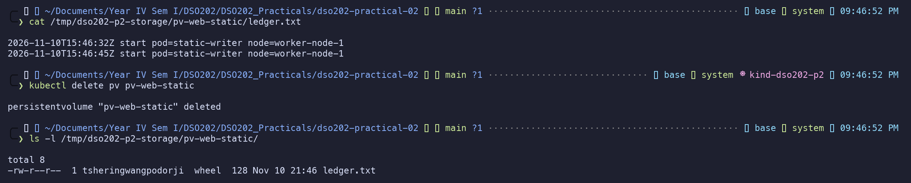

**Step 10 – New objects adopt old data.** A new PV, claim and Pod read a ledger
of three lines (15:46:32, 15:46:45, 15:46:56 UTC), two of them written before any
of these objects existed.

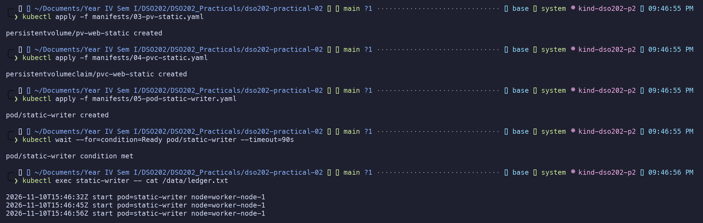

**Checkpoint met:** `ledger.txt` holds three lines, and the PV entered
`Released` because Retain refuses to give one claim's data to another.

### 3.3 Stage 3 – Dynamic provisioning, and two uncomfortable truths

**Steps 1–2 – A claim that will not bind.** The claim stayed `Pending`, and the
event explains why: *waiting for first consumer to be created before binding*.
This is correct behaviour, not a fault.

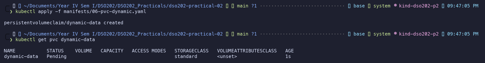

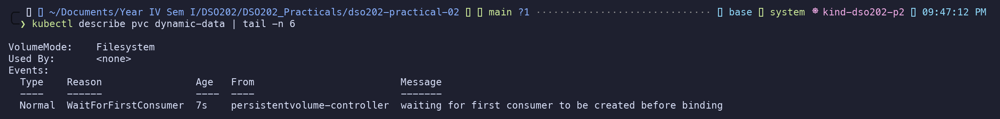

**Step 3 – A consumer triggers provisioning.** Once the Pod existed, the claim
bound to `pvc-d7161356-…`, a PV nobody wrote. Its name is `pvc-` plus the claim's
UID, and it inherited `Delete` from the class, not from the claim.

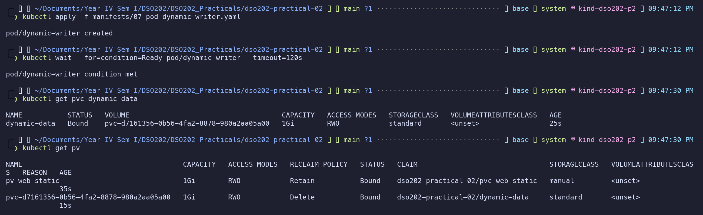

**Step 4 – The volume is a directory on one node.** The Pod ran on
`worker-node-2`, so the directory
`pvc-d7161356-…_dso202-practical-02_dynamic-data` is inside `dso202-p2-worker2`.

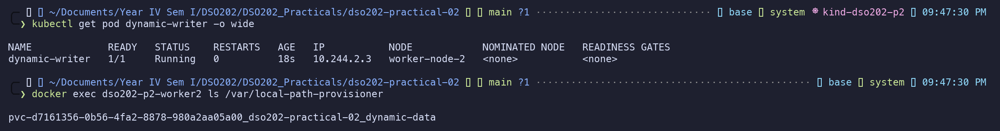

**Step 5 – First truth: the size is not a limit.** The claim asked for 1Gi, but
the container sees the node's whole 58.4G disk. A Pod could fill the node and
evict others, and a laptop cluster cannot test "volume full" behaviour.

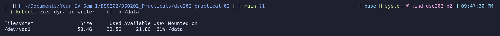

**Step 6 – Second truth: the volume cannot grow.** The API server rejected the
resize because the class has `allowVolumeExpansion: false`.

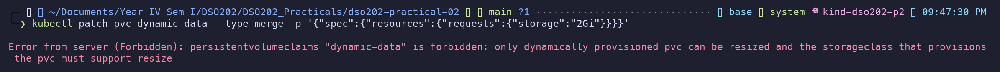

**Step 7 – What Delete means.** After the Pod and claim were deleted, the
dynamic PV and its node directory were both gone (the last command printed
nothing). The only PV left was the static `pv-web-static` from Stage 2, which
the guide's sample output does not show because it assumes Stage 2 was cleaned
up.

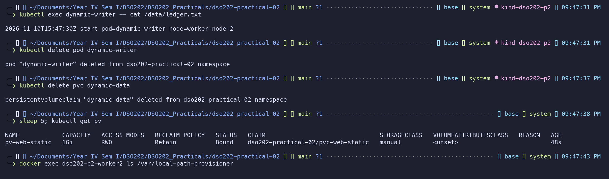

### 3.4 Stage 4 – Why a Deployment cannot own state

> This stage is a **deliberate failure**, built to show what goes wrong. The
> three replicas sharing one volume are an anti-pattern, not a successful
> deployment.

**Observation 1 – The volume dictated placement.** All three replicas ran on
`worker-node-2`, although the Deployment expresses no node preference. The
claim was bound to a volume on that node, so no other node could accept them.

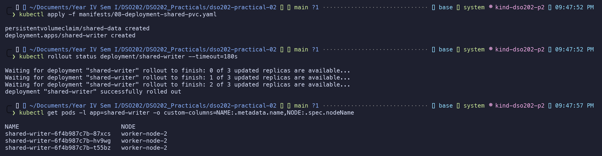

**Observation 2 – One set of data, not three.** Three processes appended to the
same file on the same volume. A web server can tolerate this; a database cannot,
because two database processes writing one data directory corrupt it.

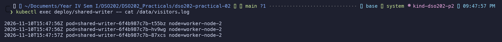

**Observation 3 – No identity survives.** After the running replicas were
deleted, every replacement had a new random name (`87xcs`, `hv9wg`, `t55bz`
became `9jmh8`, `b8lxd`, `nv7lv`). Nothing can refer to "the first replica" and
mean the same thing after a restart. The shared log now mixes six Pod names.

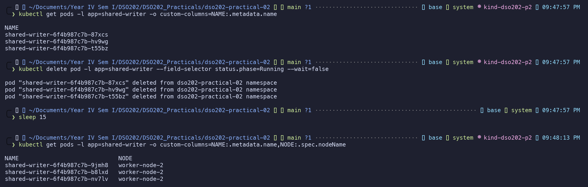

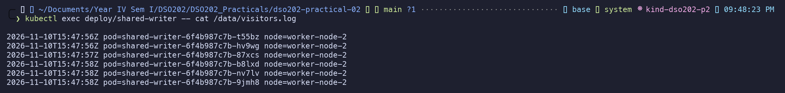

**Step 4 – Removed.** On a managed cloud cluster this would fail more loudly:
replicas scheduled to another node would report a *Multi-Attach error*. Here
`ReadWriteOnce` (one **node**, not one Pod) let it run silently, which is why
this configuration looks fine locally and fails in production.

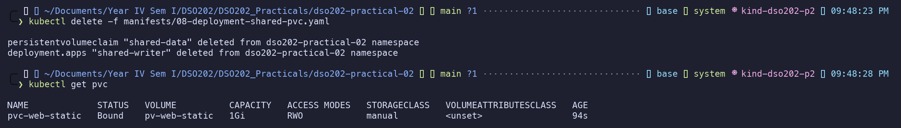

### 3.5 Stage 5 – StatefulSets and stable identity

**Step 1 – Headless Service first.** `CLUSTER-IP None`: no virtual IP and no load
balancing. The Service exists to publish DNS records.

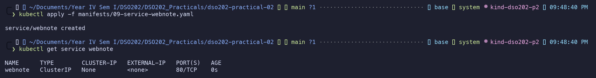

**Step 2 – Ordered creation.** The names are ordinals, not hashes, and
`webnote-1` was not created until `webnote-0` was `Running` and `1/1`
(`OrderedReady`). The watch was stopped with Ctrl-C while `webnote-1` was still
initialising, during the first pull of the nginx image.

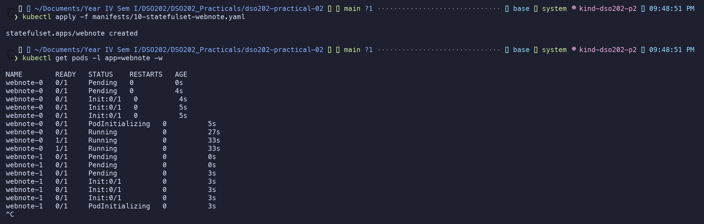

**Step 3 – One claim per ordinal.** The claims follow
`<template>-<statefulset>-<ordinal>`: `content-webnote-0`, `-1`, `-2`. They can
be selected with `-l app=webnote` only because Listing 12 puts labels in the
claim template.

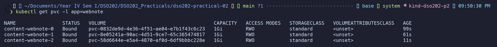

**Step 4 – Placement is free again.** Each Pod has its own volume, so the Pods
spread across both workers.

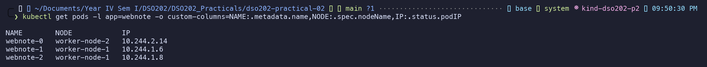

**Step 5 – DNS.** The set name resolved to all three Pod addresses; the per-Pod
name `webnote-0.webnote.dso202-practical-02.svc.cluster.local` resolved to one
(`10.244.2.14`). A ClusterIP Service would have returned one virtual address and
hidden the Pods.

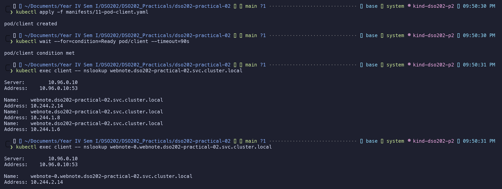

**Steps 6–7 – One specific Pod, and the EndpointSlice behind it.**

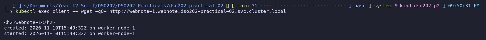

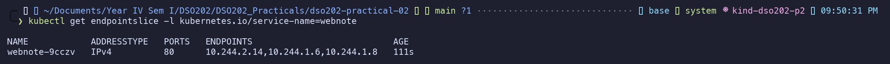

**Step 8 – Volumes are private.** A note written into `webnote-0` appears only
in `webnote-0`'s page.

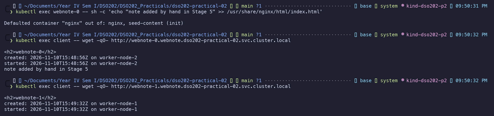

**Step 9 – Identity and storage survive deletion.** Before deletion,
`webnote-1` was on `worker-node-1` at `10.244.1.6`.

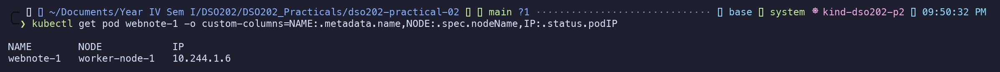

After deletion, four facts are visible. The **name** is unchanged. The **claim**
`content-webnote-1` was reattached, not recreated (its age is greater than the
Pod's). The **`created:` line** still says 15:49:32Z, so the file was not
regenerated. The **IP** changed to `10.244.1.9`, which is why clients must use
the DNS name and never an address.

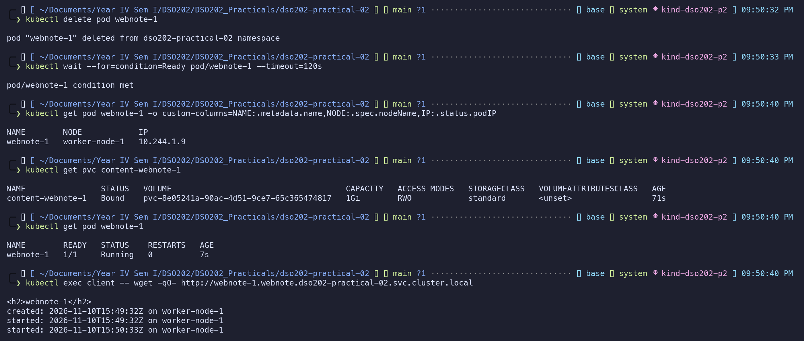

**Checkpoint met:** stable name (Step 9), stable storage (Steps 3, 8, 9), stable
network identity (Step 5) and ordered operations (Step 2) are each matched to an
output.

### 3.6 Stage 6 – Scaling, retention, and ordered updates

**Step 1 – Scaling up creates storage.** A fourth claim appeared with
`webnote-3`. The quota is what stops a mistyped `--replicas=400`.

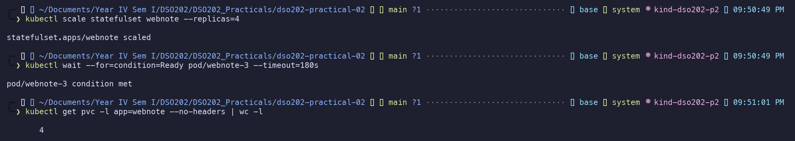

**Step 2 – Scaling down is ordered.** `webnote-3` terminated first, then
`webnote-2`, one at a time and highest ordinal first.

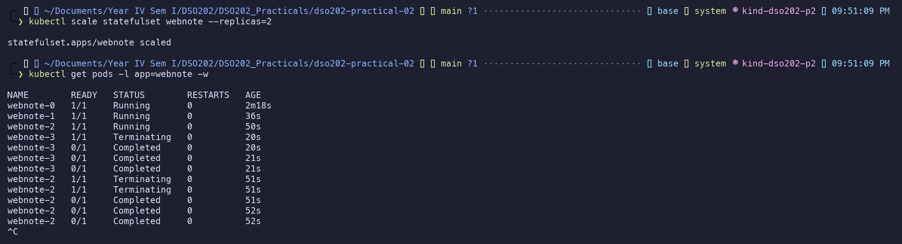

**Step 3 – Two Pods, four claims.** `whenScaled: Retain` (the default) kept the
data of the removed replicas.

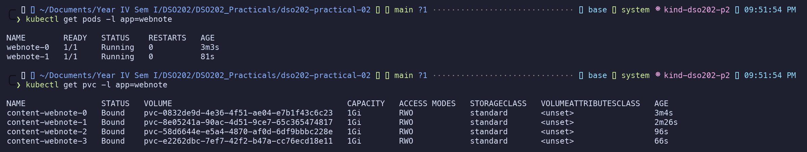

**Step 4 – The ordinal is the identity.** Scaling back to three recreated
`webnote-2`, which reclaimed `content-webnote-2` by name. Its original
`created: 15:50:23Z` line is back.

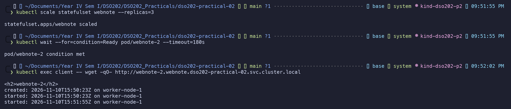

**Step 5 – Partitioned update.** The committed manifest was edited (not patched)
to `partition: 2` and `nginx:1.31-alpine`. Only ordinal 2 was updated, a canary
that a Deployment has no equivalent for.

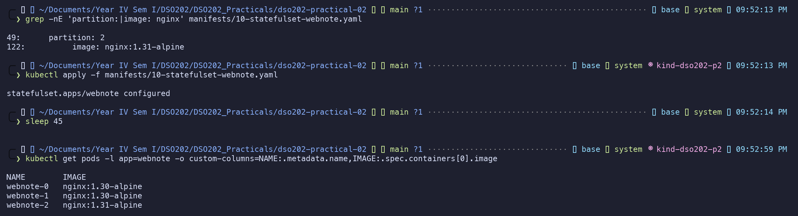

**Step 6 – Complete the rollout.** With `partition: 0` the rest updated, in
descending order. `webnote-0` still shows its original `created:` line and the
Stage 5 note, so the upgrade did not touch the data. `kubectl explain` confirms
that `maxUnavailable` is beta on this cluster version.

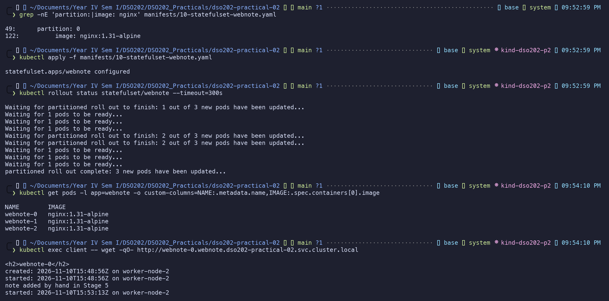


**Steps 7–8 – Delete the controller, keep the data.** Deleting the StatefulSet
removed every Pod but none of the four claims (`whenDeleted: Retain`).
Re-applying it brought the workload back. `webnote-1` shows its 15:49:32Z
`created:` line plus one more `started:` line, the clearest single evidence for
the Functional Requirements criterion.


**Checkpoint met:** four claims exist, three Pods run `nginx:1.31-alpine`, and
both retention fields were observed.

### 3.7 Stage 7 – A real stateful application: PostgreSQL

**Step 1 – A Secret is not encryption.** Anyone allowed to read Secrets in the
namespace recovered `taskuser` with one command. Restricting that is RBAC's job.


**Step 2 – Two Services.** `postgres-headless` gives the Pod its stable DNS name
and is the StatefulSet's `serviceName`. `postgres` is an ordinary ClusterIP
Service and is the host an application puts in its connection string.


**Step 3 – Deploy.** The first image pull took **4 min 17 s**, so the watch was
stopped while the Pod was still `ContainerCreating`. The events and the log
show the rest. The log also shows why the readiness probe uses
`-h 127.0.0.1`: during first start, initdb's *temporary* server already reported
"ready to accept connections" before the real server started.


**Step 4 – Retained storage.** The claim names `dso202-retain`, so its PV has
reclaim policy `Retain`, the standard choice for a database.


**Step 5 – The data directory is below the mount point.** `PGDATA` is
`/var/lib/postgresql/18/docker`, and the volume is mounted at
`/var/lib/postgresql`.


**Step 6 – Write data.**


**Step 7 – Delete the database Pod.** This is the test the whole practical
builds towards: three rows, written by a process that no longer exists, read
back through a Pod that did not exist when they were written.


**Step 8 – What the database did with the volume.** "Database directory appears
to contain a database; Skipping initialization", and no `init process complete`
line. The database also reports a clean shutdown, thanks to the 60 s
`terminationGracePeriodSeconds`.


**Step 9 – Claim reused, both names resolve.** `postgres` returns the ClusterIP
(`10.96.191.169`) that an application would use; `postgres-0.postgres-headless`
returns the Pod address (`10.244.2.22`) that a backup job or replica would use.


### 3.8 Stage 8 – Cleanup, and the cost of Retain

**Step 1 – Capture evidence first.** This included a `pg_dump`. A logical dump
held outside the cluster is a backup; a retained volume is not.


**Steps 2–3 – Delete the workloads; the claims survive.** Six claims remained.
StatefulSet claims were never in a manifest, so `kubectl delete -f` never
removes them.


**Step 4 – The two policies diverge.** The four `standard` volumes disappeared
with their claims. The two `Retain` volumes are `Released` and still hold
everything, including the `tasks` table.


**Step 5 – Removing the object does not remove the storage.** After
`pv-web-static` was deleted, its file was still on the Mac. Even after the
PostgreSQL PV was deleted, its data directory (`PG_VERSION`, `base`, `global`,
…) was still on `worker-node-2`. In a cloud this is the difference between a
deleted cluster and a continuing invoice.


**Steps 6–7 – The final asymmetry.** Deleting the cluster destroyed every
dynamically provisioned volume, including the database, because they lived
inside the nodes. The statically provisioned ledger is still on the host,
because it never lived inside the cluster. A PersistentVolume is a description
of storage, never the storage itself.


### 3.9 Extension tasks

**Extension 1 – A destructive retention policy.**
[`extensions/ext1-statefulset-whenscaled-delete.yaml`](extensions/ext1-statefulset-whenscaled-delete.yaml)
is a copy named `webnote-ext1` with `whenScaled: Delete`. Scaling from three to
one deleted the claims of ordinals 1 and 2 together with their Pods.


`Retain` is the default because scaling down is often a reaction to an incident,
and destroying data during an incident cannot be undone. `Delete` is right for a
workload whose volume is only a rebuildable cache, for example a CI build cache
or a search index that can be regenerated from the source of truth.

**Extension 2 – An immutable field.** Applying `podManagementPolicy: Parallel`
to the live StatefulSet was rejected. The error itself lists the fields that
may change: `replicas`, `ordinals`, `template`, `updateStrategy`,
`revisionHistoryLimit`, `persistentVolumeClaimRetentionPolicy` and
`minReadySeconds`. `podManagementPolicy`, `serviceName`, `selector` and
`volumeClaimTemplates` cannot change.


After the StatefulSet was deleted and the Parallel manifest applied, all three
Pods were created at once (all `0s`), unlike Stage 5. The original
`OrderedReady` StatefulSet was then restored.


**Extension 3 – Ordinals starting at 2.** `kubectl explain` confirmed that
`spec.ordinals.start` exists on v1.36. With it, the Pods were `webnote-ext3-2`
and `webnote-ext3-3`, and the claims were `content-webnote-ext3-2` and `-3`. This
is useful when migrating a StatefulSet between clusters one replica at a time:
the old cluster keeps ordinals 0–1 while the new one takes over from 2, so no
two members ever share a name.


**Extension 4 – Restore from the dump.** The cluster was rebuilt and only the
database redeployed. The new database had no `tasks` table until the dump was
restored.


Then `DROP TABLE tasks` was run and the Pod deleted. The table was **still gone**
after the restart: volume-level persistence faithfully preserved the mistake.
Only the dump brought it back.


Volume persistence protects against losing a *Pod*. A logical backup protects
against losing *data*, including a dropped table. Finally, the cluster was
deleted and no `kindest/node` container remained.


---

## 4. Analysis

**Q1. Why did the Stage 3 claim stay Pending while the Stage 2 claim bound at once?**
The field is `volumeBindingMode` on the StorageClass. `standard` uses
`WaitForFirstConsumer`, and the event said "waiting for first consumer to be
created before binding" ([s3-step2](screenshots/s3-step2-describe.png)). The
Stage 2 claim named class `manual`, for which no StorageClass object exists
(`NotFound`, [s2-step4](screenshots/s2-step4-no-manual-class.png)), so no binding
mode applied and it bound at once to the matching `Available` PV. The design
reason is topology: with node-local or zonal storage, creating the volume before
the scheduler has picked a node could put the data where the Pod cannot run.
Waiting lets the scheduler choose first. The `dynamic-writer` volume was created
on `worker-node-2`, the node the Pod was scheduled to
([s3-step4](screenshots/s3-step4-node-dir.png)).

**Q2. Which object decided whether data survived claim deletion, and who chooses it?**
The reclaim policy. For the dynamic volume it came from the **StorageClass**
(`standard`, `Delete`), and the PV inherited it
([s3-step3](screenshots/s3-step3-consumer.png)). For the static volume it was set
on the **PersistentVolume** itself (`persistentVolumeReclaimPolicy: Retain`).
Nothing in the claim can override either. In an organisation, StorageClasses
and static PVs are created by the platform or cluster administrators, not by the
developer who writes the claim, and they normally choose `Retain` for database
classes.

**Q3. Why were all three Stage 4 replicas on one node?**
The first Pod caused the single claim `shared-data` to be provisioned as a
local-path volume on `worker-node-2`. That PV carries node affinity for that
node, so the scheduler's volume-binding check filtered out every other node for
the other replicas ([s4-step1](screenshots/s4-step1-shared-deploy.png)). Because
`ReadWriteOnce` means one *node*, all three mounted it. On a managed cluster with
a zonal disk (e.g. AWS EBS), the disk attaches to one node at a time. Replicas
placed on other nodes would stay in `ContainerCreating` with a *Multi-Attach
error … Volume is already used by pod(s)* event, and replicas in another zone
could not be placed at all.

**Q4. FQDN of the second webnote replica, and what must exist for it to resolve.**
`webnote-1.webnote.dso202-practical-02.svc.cluster.local` (`10.244.1.6`, then
`10.244.1.9` after deletion; [s5-step9](screenshots/s5-step9-survive.png)).
Required: the Namespace `dso202-practical-02`; the headless Service `webnote`
(`clusterIP: None`) whose selector matches the Pod; the StatefulSet with
`serviceName: webnote`, which sets the Pod's hostname and subdomain; the Pod
`webnote-1` itself, **Ready** (because `publishNotReadyAddresses: false`); the
EndpointSlice generated for the Service
([s5-step7](screenshots/s5-step7-endpointslice.png)); and CoreDNS running in
`kube-system`.

**Q5. What happened to the claims when scaling 4 → 2 → 3?**
At 4 replicas a fourth claim `content-webnote-3` was created (count 4,
[s6-step1](screenshots/s6-step1-scale-up.png)). Scaling to 2 terminated
`webnote-3` then `webnote-2`, but all four claims stayed `Bound`
([s6-step3](screenshots/s6-step3-claims-retained.png)). Scaling back to 3
recreated `webnote-2`, which reattached `content-webnote-2` with its original
`created: 15:50:23Z` ([s6-step4](screenshots/s6-step4-scale-back.png));
`content-webnote-3` stayed unused. The fields are
`persistentVolumeClaimRetentionPolicy.whenScaled` and `.whenDeleted`. Both
default to `Retain`, and Extension 1 showed the opposite with
`whenScaled: Delete`.

**Q6. Why mount at `/var/lib/postgresql` and not at the data directory?**
PostgreSQL 18's image puts `PGDATA` at `/var/lib/postgresql/18/docker`
([s7-step5](screenshots/s7-step5-pgdata.png)). Mounting the volume at the parent
lets `initdb` create a fresh, empty subdirectory inside the volume. If the volume
were mounted directly at the data directory and the storage backend had put
anything there (e.g. `lost+found` on an ext4 block device), `initdb` would refuse
a non-empty directory. The container would then go into `CrashLoopBackOff` on
first start only, with the "directory exists but is not empty" error in
`kubectl logs postgres-0 --previous`. For PostgreSQL 17 and earlier the
equivalent fix is `subPath`.

**Q7. Two things a StatefulSet does not provide for a database.**
(1) *Replication and failover:* three replicas are three independent databases.
In production this comes from a database **Operator** (e.g. CloudNativePG;
Unit II 2.4), which sets up streaming replication and leader election.
(2) *Backup:* a retained volume is not a backup. Extension 4 showed `DROP TABLE`
surviving a Pod restart ([ext4-c](screenshots/ext4-c-drop-table.png)). Backups
come from scheduled logical dumps (a **CronJob** running `pg_dump`),
Operator-managed WAL archiving to object storage, or CSI **VolumeSnapshots**.
Access to the credentials Secret must also be restricted with **RBAC**.

**Q8. Why were the two PVs `Released` rather than `Available` in Stage 8?**
With `Retain`, deleting the claim does not wipe the volume, and the PV still
records its old claim (`CLAIM dso202-practical-02/data-postgres-0` after the
claim was gone, [s8-step4](screenshots/s8-step4-delete-claims.png)). Kubernetes
will not bind a volume that may hold one workload's data to a different claim.
To return it to service, an administrator must first decide what to do with the
data (back it up, wipe it, or keep it). Then they either delete and recreate
the PV, or remove `spec.claimRef`
(`kubectl patch pv <name> --type json -p '[{"op":"remove","path":"/spec/claimRef"}]'`)
so that it becomes `Available`. For dynamically provisioned volumes they must
also delete the backing storage by hand, as the leftover
`pvc-2b1ac828-…_data-postgres-0` directory showed
([s8-step5b](screenshots/s8-step5b-delete-pg-pv.png)).

---

## 5. Reflection

> *Draft written from what happened in the runs. Review it and put it in your own
> words before submitting.*

**What was difficult.** The hardest idea was keeping three things apart: the
PersistentVolume *object*, the claim, and the bytes on disk. Stage 2 made it
concrete. I deleted the PV and the ledger was still on my Mac. In Stage 8, I
deleted the database PV and its directory was still on `worker-node-2`.

**Error 1 – a path that "does not exist".** Partway through Stage 5,
`kubectl apply -f manifests/10-statefulset-webnote.yaml` failed with
`error: the path "manifests/10-statefulset-webnote.yaml" does not exist`. The
headless Service had applied a moment earlier, so the file obviously existed. I
diagnosed it with `pwd`: my shell had returned to the repository root
(`DSO202_Practicals/`), one level above `dso202-practical-02/`, and every
manifest path is relative. After `cd dso202-practical-02` the apply worked. The
lesson is that relative paths in a README only work from one directory, which is
why the rebuild sequence below says where to run it.

**Error 2 – a database that looked stuck.** In Stage 7, `postgres-0` stayed in
`ContainerCreating` for several minutes and my watch ended before it was Ready.
Instead of guessing, I ran
`kubectl get events --field-selector involvedObject.name=postgres-0`, which
showed `Pulling image "postgres:18-alpine"` and then
`Successfully pulled image … in 4m17.725s`. The cause was a slow first image
pull, not a Kubernetes fault. Because of the readiness probe, no traffic would
have been sent to it early. The same log also showed initdb's temporary server
saying "ready to accept connections" before the real server started, which
explains why the probe forces a TCP check with `-h 127.0.0.1`.

**Error 3 (first run, 2 Nov) – the disk.** In the first run, `df -h /data` in
Stage 3 showed the Docker VM's disk at 99% used. `docker system df` showed about
21 GB of build cache from other projects. After `docker builder prune -f`, the
node had enough room for the PostgreSQL and nginx images. Without that check,
the likely symptom later would have been `ImagePullBackOff` or "no space left on
device", easily misread as a Kubernetes problem.

**What I would do differently.** Check `docker system df` (not only the host's
`df -h /`) in Stage 0, pre-pull `postgres:18-alpine` and `nginx:1.31-alpine`,
and take a `pg_dump` right after inserting data rather than only at cleanup.

**What remains unclear.** Stage 4 Step 3 says "delete one replica", but the
command (`--field-selector status.phase=Running`) deletes every running replica,
which is what I observed. I am also not sure why the scheduler put two webnote
Pods on `worker-node-1` and one on `worker-node-2` rather than spreading them
differently. No spread constraint was set, so I assume it followed the default
scoring, but I have not verified which scoring plugin decided it.

---

## 6. References

1. DSO202 Practical 2 Guide and companion file `DSO202_Practical2_Manifests.md` (HackMD). Accessed 10 November 2026.
2. Kubernetes documentation, "Persistent Volumes". https://kubernetes.io/docs/concepts/storage/persistent-volumes/ Accessed 10 November 2026.
3. Kubernetes documentation, "Storage Classes". https://kubernetes.io/docs/concepts/storage/storage-classes/ Accessed 10 November 2026.
4. Kubernetes documentation, "StatefulSets". https://kubernetes.io/docs/concepts/workloads/controllers/statefulset/ Accessed 10 November 2026.
5. Kubernetes documentation, "DNS for Services and Pods". https://kubernetes.io/docs/concepts/services-networking/dns-pod-service/ Accessed 10 November 2026.
6. Kubernetes documentation, "Secrets". https://kubernetes.io/docs/concepts/configuration/secret/ Accessed 10 November 2026.
7. Docker Hub, "postgres" official image (PGDATA and the PostgreSQL 18 layout). https://hub.docker.com/_/postgres Accessed 10 November 2026.
8. kind documentation, "Configuration" (extraMounts, kubeadmConfigPatches). https://kind.sigs.k8s.io/docs/user/configuration/ Accessed 10 November 2026.
9. Rancher local-path-provisioner README. https://github.com/rancher/local-path-provisioner Accessed 10 November 2026.

---

## 7. Appendix – Repository layout, rebuild and cleanup

### Repository layout

```
dso202-practical-02/
├── README.md                          # this report + rebuild/cleanup
├── cluster/
│   └── kind-cluster.yaml              # Listing 1  - 3 nodes, host dir mounted into worker-node-1
├── manifests/
│   ├── 00-namespace.yaml              # Listing 2  - Namespace dso202-practical-02
│   ├── 01-quota-and-limits.yaml       # Listing 3  - ResourceQuota (incl. storage caps) + LimitRange
│   ├── 02-storageclass-retain.yaml    # Listing 4  - StorageClass dso202-retain (cluster-scoped)
│   ├── 03-pv-static.yaml              # Listing 5  - static PersistentVolume (cluster-scoped)
│   ├── 04-pvc-static.yaml             # Listing 6  - claim for the static volume
│   ├── 05-pod-static-writer.yaml      # Listing 7  - Pod appending to ledger.txt
│   ├── 06-pvc-dynamic.yaml            # Listing 8  - dynamically provisioned claim
│   ├── 07-pod-dynamic-writer.yaml     # Listing 9  - first consumer of that claim
│   ├── 08-deployment-shared-pvc.yaml  # Listing 10 - ANTI-PATTERN: 3 replicas, 1 volume
│   ├── 09-service-webnote.yaml        # Listing 11 - headless Service
│   ├── 10-statefulset-webnote.yaml    # Listing 12 - webnote StatefulSet (nginx:1.31-alpine after Stage 6)
│   ├── 11-pod-client.yaml             # Listing 13 - busybox client for DNS/HTTP tests
│   ├── 12-secret-postgres.yaml        # Listing 14 - PostgreSQL credentials (practice values only)
│   ├── 13-service-postgres.yaml       # Listing 15 - headless + ClusterIP Services
│   └── 14-statefulset-postgres.yaml   # Listing 16 - PostgreSQL StatefulSet
├── extensions/                        # Extension 1-3 manifests (NOT applied by 'apply -f manifests/')
├── screenshots/                       # terminal screenshots of every step (<stage>-<step>.png)
├── evidence/                          # stage output, final state and SQL dump from the first run (2 Nov)
│   └── logs/                          # plain-text output behind each screenshot, final state, SQL dump
└── report/
    └── practical-02-report.md         # earlier copy of the report
```

Files are numbered so that `kubectl apply -f manifests/` applies them in
dependency order. Every namespaced object states
`namespace: dso202-practical-02`; the StorageClass and the PersistentVolume carry
no namespace because they are cluster-scoped. Every object carries the labels
`app`, `tier`, `dso202/practical: "02"` and `dso202/managed-by: declarative`.

### Rebuild from an empty machine

Run every command from inside `dso202-practical-02/` (see Reflection, Error 1).

```bash
# 0. Tools, and the host directory the static volume lives in.
#    It MUST exist before the cluster is created.
docker info --format '{{.ServerVersion}}'
kind version
kubectl version --client
kind delete cluster --name dso202 2>/dev/null || true   # Practical 1 cluster, if any
mkdir -p /tmp/dso202-p2-storage

# 1. Cluster, namespace, quota, retaining StorageClass
kind create cluster --config cluster/kind-cluster.yaml
kubectl wait --for=condition=Ready nodes --all --timeout=180s
kubectl apply -f manifests/00-namespace.yaml
kubectl config set-context --current --namespace=dso202-practical-02
kubectl apply -f manifests/01-quota-and-limits.yaml
kubectl apply -f manifests/02-storageclass-retain.yaml

# 2. Static provisioning
kubectl apply -f manifests/03-pv-static.yaml -f manifests/04-pvc-static.yaml
kubectl apply -f manifests/05-pod-static-writer.yaml
kubectl wait --for=condition=Ready pod/static-writer --timeout=90s
kubectl exec static-writer -- cat /data/ledger.txt

# 3. Dynamic provisioning (claim stays Pending until the Pod exists)
kubectl apply -f manifests/06-pvc-dynamic.yaml -f manifests/07-pod-dynamic-writer.yaml
kubectl wait --for=condition=Ready pod/dynamic-writer --timeout=120s

# 4. The anti-pattern - observe, then remove
kubectl apply -f manifests/08-deployment-shared-pvc.yaml
kubectl rollout status deployment/shared-writer --timeout=180s
kubectl delete -f manifests/08-deployment-shared-pvc.yaml

# 5. StatefulSet + headless Service + client
kubectl apply -f manifests/09-service-webnote.yaml
kubectl apply -f manifests/10-statefulset-webnote.yaml
kubectl rollout status statefulset/webnote --timeout=300s
kubectl apply -f manifests/11-pod-client.yaml
kubectl exec client -- wget -qO- http://webnote-0.webnote.dso202-practical-02.svc.cluster.local

# 6. PostgreSQL (first image pull can take several minutes)
kubectl apply -f manifests/12-secret-postgres.yaml -f manifests/13-service-postgres.yaml
kubectl apply -f manifests/14-statefulset-postgres.yaml
kubectl rollout status statefulset/postgres --timeout=600s
kubectl exec postgres-0 -- psql -U taskuser -d tasktracker -c 'SELECT 1;'

# Optional: restore the captured data
kubectl exec -i postgres-0 -- psql -U taskuser -d tasktracker < evidence/logs/tasktracker-dump.sql
```

`kubectl apply -f manifests/` also works in one step, but it recreates the
Stage 4 anti-pattern (file `08`) along with everything else. Delete it again
with `kubectl delete -f manifests/08-deployment-shared-pvc.yaml`.

### Cleanup

Deleting the workloads does **not** delete the storage. Claims generated by a
StatefulSet are in no manifest, and volumes from the `dso202-retain` class are
kept after their claim is deleted.

```bash
# 1. Back up first - a retained volume is not a backup
kubectl exec postgres-0 -- pg_dump -U taskuser -d tasktracker > evidence/logs/tasktracker-dump.sql

# 2. Workloads
kubectl delete -f manifests/14-statefulset-postgres.yaml
kubectl delete -f manifests/10-statefulset-webnote.yaml
kubectl delete -f manifests/11-pod-client.yaml
kubectl delete -f manifests/05-pod-static-writer.yaml

# 3. Claims no manifest created (StatefulSet claims) and the static claim
kubectl get pvc
kubectl delete pvc --all

# 4. Volumes with reclaimPolicy Retain are now Released, not gone
kubectl get pv
kubectl delete pv pv-web-static
kubectl delete pv <name-of-the-released-postgres-pv>

# 5. Context and cluster
kubectl config set-context --current --namespace=default
kind delete cluster --name dso202-p2

# 6. The host directory survives 'kind delete cluster' - remove it last
ls -l /tmp/dso202-p2-storage/pv-web-static/
rm -rf /tmp/dso202-p2-storage

# Optional: reclaim the ~1 GB node image
docker image rm kindest/node:v1.36.1
```
